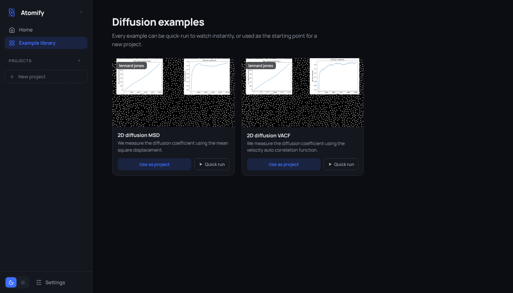

# Atomify examples template

Make your own example library for [Atomify](https://andeplane.github.io/atomify), for a course, a workshop or a paper. Each example is a LAMMPS input script plus an optional Jupyter notebook, and students open it with one link: no install, everything runs in the browser.

➡️ **[Open this template in Atomify](https://andeplane.github.io/atomify/?examplesUrl=https%3A%2F%2Fraw.githubusercontent.com%2Fandeplane%2Fatomify-examples-template%2Fmain%2Fexamples.json)**



## Make your own

1. Click **Use this template** (top right) to create your own repository. It must be public so Atomify can download the files.
2. Add or change examples (see below), commit and push.
3. Share this link, with your user and repository name filled in:

   ```
   https://andeplane.github.io/atomify/?examplesUrl=https://raw.githubusercontent.com/<user>/<repository>/main/examples.json
   ```

   Every push also prints the exact link in the summary of the **Validate examples** GitHub Actions run.

All paths in `examples.json` are relative to `examples.json` itself, so nothing needs editing after you copy, rename or fork the repository. GitHub caches raw files for a few minutes, so a push can take up to five minutes to show up.

## Add an example

```
python3 scripts/new_example.py my-example "My example"
```

This creates `my-example/` with an input script, a notebook and a placeholder image, and adds the entry to `examples.json`. Then:

- edit `my-example/my-example.in` (lines starting with `#/` are Atomify visualizer commands, such as `#/atom 1 1.0 #ffffff`),
- adapt the notebook, and replace `my-example/my-example.png` with a screenshot (roughly 16:9),
- run `python3 scripts/validate.py`.

The scripts need only Python 3.9 or newer, with no packages to install.

## Try it locally

```
python3 scripts/serve.py
```

and open the link it prints. It serves this folder on `http://localhost:8000` with the headers Atomify needs, so you can edit files and just reload Atomify. Chrome and Firefox allow the hosted Atomify to load from `localhost` (Chrome may ask you to allow access to your local network). Safari blocks it, so use another browser for local work.

If you are also developing Atomify itself, point the link at your dev server with `python3 scripts/serve.py --atomify http://localhost:5173/atomify/`.

## The format of `examples.json`

```json
{
  "$schema": "./examples.schema.json",
  "title": "Diffusion examples",
  "descriptionFile": "description.md",
  "examples": [
    {
      "id": "2d-msd-diffusion",
      "title": "2D diffusion MSD",
      "description": "We measure the diffusion coefficient using the mean square displacement.",
      "imageUrl": "2d-msd-diffusion/2d-msd-diffusion.png",
      "inputScript": "2d-msd-diffusion.in",
      "analysisScript": "2d-msd-diffusion.ipynb",
      "keywords": ["lennard jones", "diffusion"],
      "files": [
        { "fileName": "2d-msd-diffusion.in", "url": "2d-msd-diffusion/2d-msd-diffusion.in" },
        { "fileName": "2d-msd-diffusion.ipynb", "url": "2d-msd-diffusion/2d-msd-diffusion.ipynb" }
      ]
    }
  ]
}
```

| Field | |
| --- | --- |
| `title` | Heading of the example library. |
| `descriptionFile` | Optional Markdown file about the whole library. |
| `examples[].id` | Unique id, by convention also the example's folder. |
| `examples[].title`, `description` | Shown on the example's card. |
| `examples[].imageUrl` | Card image. |
| `examples[].inputScript` | `fileName` of the LAMMPS script to run. Must be in `files`. |
| `examples[].analysisScript` | Optional `fileName` of the notebook to analyse runs with. Must be in `files`. |
| `examples[].analysisDescription` | Optional Markdown for the notebook Atomify generates when there is no `analysisScript`. |
| `examples[].keywords` | Optional tags. The first one shows on the card. |
| `examples[].files` | Every file the example needs: `fileName` (its name in the Atomify project) and `url` (where to download it). |

`imageUrl`, `descriptionFile` and every `url` are relative to `examples.json`, or a full `https://` URL to use a file hosted somewhere else. `baseUrl` from older versions of this template still works, but you no longer need it. [`examples.schema.json`](examples.schema.json) describes the format, so editors such as VS Code autocomplete and check `examples.json` as you type.

## Notebooks

Atomify keeps every run of a project in `runs/<run>/`, next to the project's files, and notebooks open with the project folder as their working directory. The notebooks here analyse the latest run:

```python
logs = sorted(glob.glob("runs/*/log.lammps"))
log = lammps_logfile.File(logs[-1])
```

Notebooks run in the browser with [Pyodide](https://pyodide.org), so install pure-Python packages with `%pip install` in the notebook. Clear outputs before committing to keep the repository small.

## Working with a coding agent

[`AGENTS.md`](AGENTS.md) describes the layout and rules of this repository for coding agents such as Claude Code, so you can ask one to "add an example of a 3D Lennard-Jones crystal melting" and it knows where everything goes and how to check it.
